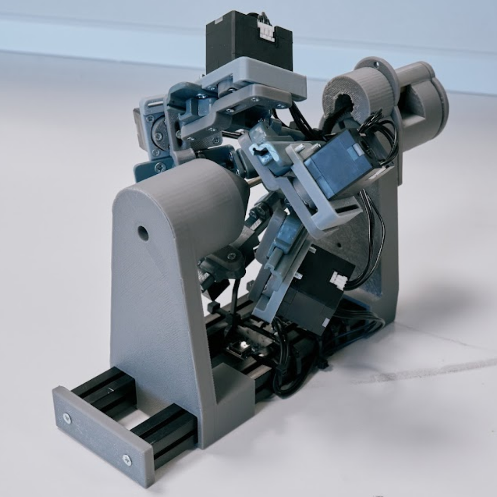
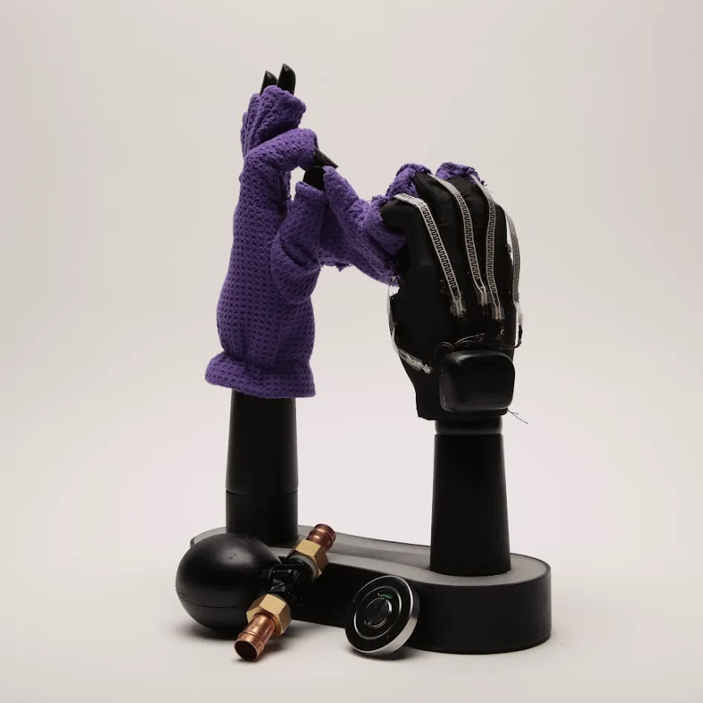
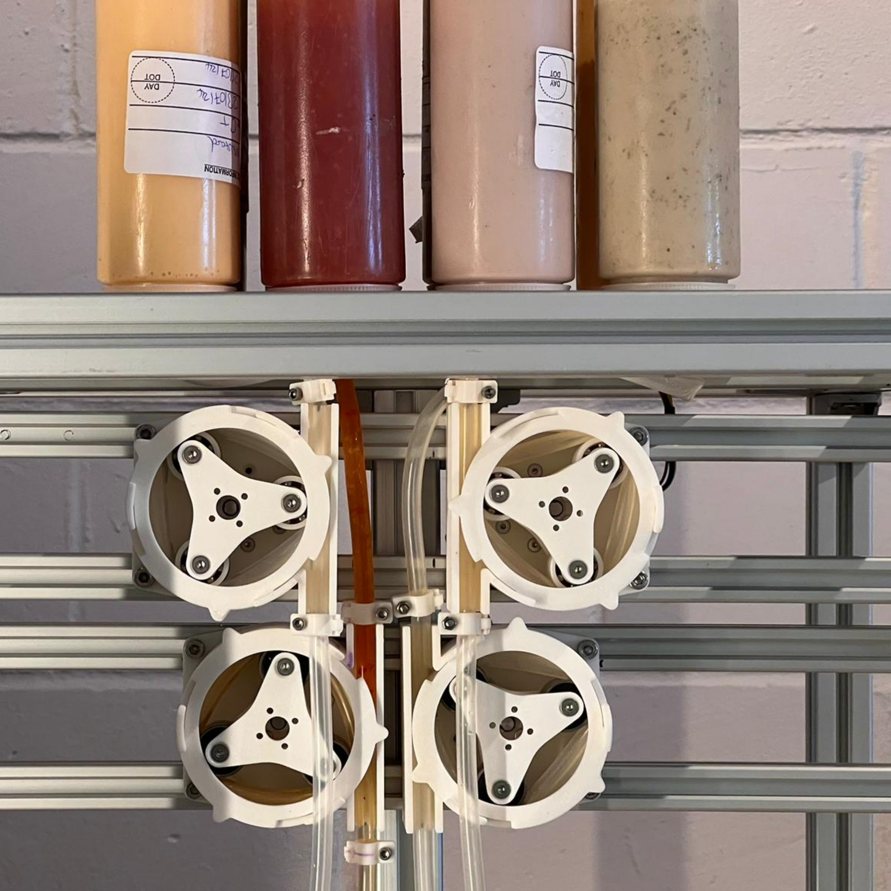
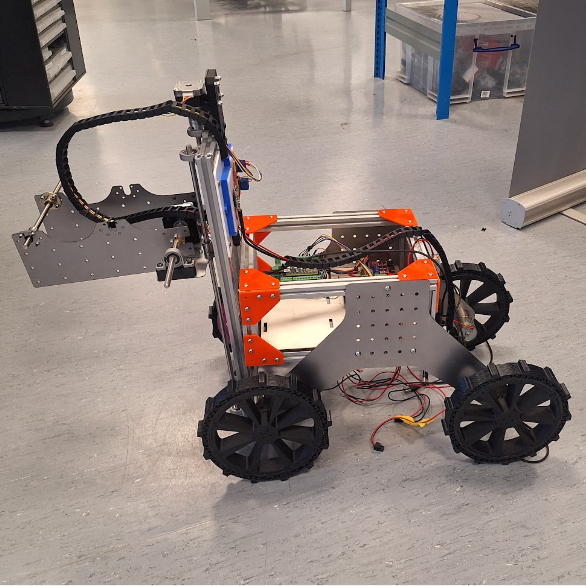

# Etienne Naude

**👋 Contact Me - [etinaude.dev/contact](https://etinaude.dev/contact)**

## 💼 Work

I am a Mechatronics/ML engineer @ Amphico, working to develop R&D scale machines to rapidly prototype new textile materials. I previously worked as a software developer @ Halter NZ and Kekeno. AS well as running the Unleash Space maker space and leading a team of 15 staff. And working as a robotics engineer @ Kaikaku and the University of Auckland.

  
  
  
  
  
  
  

## 🎓 Study 
I have a double Master's degree in Design Engineering from Imperial College London (MSc) and The Royal College of Art (MA). Previously, I studied Advanced Computer Science at the University of Auckland, where I developed a new technique in 3d printing to give 10x the smoother surfaces without any upgrades.

  
  
  
  

<!--
## 💻 Languages

   

-->

## 🔩 Projects - [etinaude.dev/projects](https://etinaude.dev/projects)

I'm currently working on a range of tech projects, from developing a lock-picking robot to inventing a new method in 3D printing to software development.

  
  
  
  

  
  
  
  

## ⚽ Hobbies

Outside of robotics and coding, I have a range of other hobbies, including woodworking, making odd things and caving.

  
  
  
  

